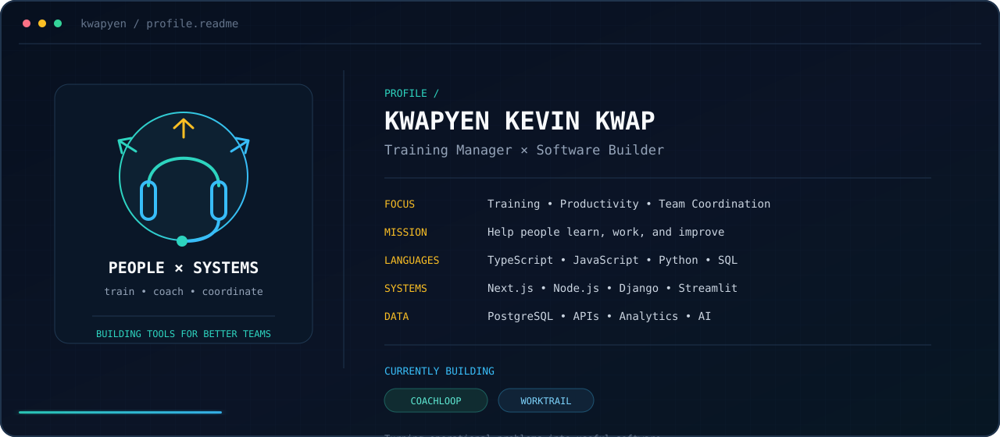

<div align="center">
  
</div>

<br />

<div align="center">

### Building practical software that helps people learn, work, and improve.

[](https://github.com/KwapyenKwap)
[](https://github.com/KwapyenKwap)

</div>

## Hello — I'm Kwapyen

I'm a **Training Manager and software builder** turning real operational problems into simple, measurable tools for training, coaching, productivity, and team coordination.

My work sits where **people development meets product engineering**. I build systems that reduce repetitive work, make progress visible, and help managers support their teams more effectively.

```text
CURRENT MISSION

Real team problem  →  Useful system  →  Measurable outcome  →  Better work
```

## What I'm Building

| Product | Purpose | Status |
| :--- | :--- | :---: |
| **CoachLoop** | Structured coaching, measurable goals, follow-ups, and employee progress | `BUILDING` |
| **WorkTrail** | A smart work diary that turns daily activities into polished shift reports | `PLANNED` |
| **Team Coordination Tools** | Lightweight systems for handoffs, accountability, and manager visibility | `EXPLORING` |

## Builder Profile

```yaml
role: Training Manager × Software Builder
focus:
  - Training and coaching systems
  - Productivity tools
  - Team coordination
  - Workflow automation
  - Operational analytics

languages: [TypeScript, JavaScript, Python, SQL]
frontend:  [React, Next.js, HTML, CSS]
backend:   [Node.js, Django, REST APIs]
data:      [PostgreSQL, Pandas]
rapid_apps: [Streamlit]
tooling:   [Git, GitHub, Docker, Codex, VS Code]
learning:  [System Design, AI Agents, Product Analytics]
```

## Tech I Use

<div align="center">


</div>

## Build Principles

```text
01  Solve a problem that actually exists.
02  Design around the person doing the work.
03  Reduce friction and repetitive effort.
04  Keep the experience simple.
05  Measure whether the system helps.
06  Improve through real feedback.
```


## Current Direction

- Building **CoachLoop** as the flagship coaching operations product
- Strengthening full-stack TypeScript and modern Node.js architecture
- Using Python for analytics, prototypes, and intelligent workflows
- Designing a connected family of tools for better training operations

<div align="center">

### Training is the domain. Software is the leverage.

<sub>Open to conversations about training technology, internal tools, productivity systems, and team operations.</sub>

</div>
